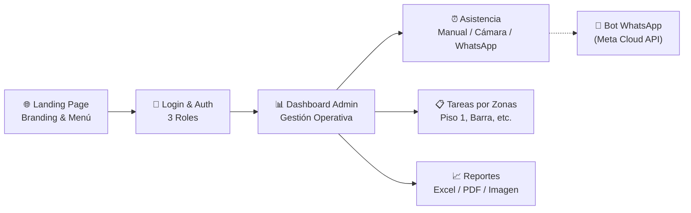
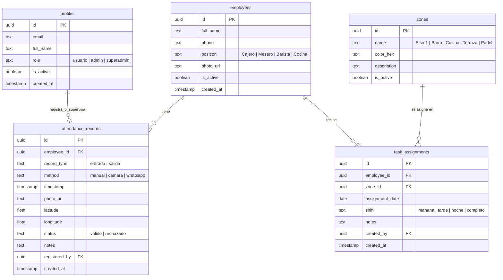

# 🍽️ Plan Maestro — Ricuras de Sal y Dulce

> Sistema web integral para el restaurante y cafetería **Ricuras de Sal y Dulce** (Loja, Ecuador).  
> Incluye Landing Page pública con branding extraído de sus redes, Sistema de Autenticación con Roles, Control de Asistencia multi-método, Gestión y Programación de Tareas por Zona, y Generador de Reportes y Exportables.

---

## 1. Visión General del Proyecto

### Módulos del Sistema

| Módulo | Propósito y Alcance | Estado / Prioridad |
|--------|---------------------|:------------------:|
| **Landing Page Pública** | Página oficial con diseño cálido acorde al branding de Instagram (cafetería, plantas, gastronomía lojana, menú sal y dulce, ubicación en Olmedo y Padel Club). | 🔴 Fase 1 (Alta) |
| **Autenticación & Roles** | Control de acceso seguro con Supabase Auth y RLS para 3 roles: `usuario`, `admin`, `superadmin`. | 🔴 Fase 1 (Alta) |
| **Control de Asistencia** | 3 métodos progresivos: 1) Botones rápidos por empleado, 2) Captura con cámara web de laptop, 3) Integración WhatsApp Bot. Tabla detallada con filtros por fecha, mes y empleado. | 🔴 Fase 1-2 (Alta) |
| **Gestión y Asignación de Tareas** | Planificador diario/semanal por zonas operativas (Piso 1, Barra, Cocina, etc.), editable y programable. | 🟠 Fase 2 (Media) |
| **Generación de Exportables** | Descarga de reportes en Excel/PDF y renderizado de imagen gráfica (PNG) con la grilla de tareas para enviar a los empleados por WhatsApp. | 🟠 Fase 2 (Media) |
| **Bot de WhatsApp Oficial** | Webhook con Meta Cloud API, validación de geocerca Haversine y foto selfie (según arquitectura original). | 🟡 Fase 3 (Futura) |

---

## 2. Branding e Identidad Visual (Extraído de Redes Sociales)

A partir del perfil oficial [@ricurasdesalydulce](https://www.instagram.com/ricurasdesalydulce/) y su presencia en Loja:

### Locaciones identificadas:
1. **Sede Matriz:** Calle José Joaquín de Olmedo 16-33 y González Suárez, Sector San Sebastián, Loja.
2. **Sede Deportiva / Wellness:** Av. Zoilo Rodríguez (Six Wellness Center / Loja Padel Club).

### Paleta de Colores para la Web y Landing:

| Color | Hex | Uso en el Diseño |
|-------|-----|------------------|
| **Espresso Profundo** | `#2C1A11` | Textos principales, encabezados, footer, botones oscuros |
| **Crema Latte** | `#FAF7F2` | Fondo general de la web (acogedor, cálido, no blanco hospitalario) |
| **Terracota / Caramelo Tostado** | `#C86D3B` | Botones de llamada a la acción (CTA: "Ver Menú", "Hacer Pedido", badges) |
| **Verde Botánico** | `#2D5A3D` | Detalles de ambientación vegetal (el local destaca por abundante vegetación viva) |
| **Dorado Café de Altura** | `#D4AF37` | Acentos gourmet, valoraciones, reconocimientos de café especial |
| **Blanco Nieve** | `#FFFFFF` | Fondo de tarjetas y contenedores de contenido |

### Estilo Tipográfico y Fotográfico:
- **Encabezados:** Fuente Serif elegante (*Playfair Display* o *Lora*), transmitiendo tradición, herencia lojana y artesanía.
- **Cuerpo y UI:** Fuente Sans moderna y legible (*Plus Jakarta Sans* o *Inter*).
- **Fotografía:** Tomas en primer plano de café de especialidad con latte art, bolones dorados, tigrillos, repostería fresca y fotos de interior con plantas colgantes.

---

## 3. Análisis Técnico de los Métodos de Marcación

```mermaid
flowchart TD
    subgraph Metodo1["1. Marcación Manual (Botón de Admin)"]
        M1A["Admin ingresa a /asistencia"] --> M1B["Vista de tarjetas con foto y nombre"]
        M1B --> M1C["Click en Entrada o Salida"]
        M1C --> M1D["Registra timestamp + ID del Admin"]
    end

    subgraph Metodo2["2. Cámara Integrada (Laptop del Local)"]
        M2A["Empleado selecciona su nombre o modo kiosko"] --> M2B["Activa cámara WebRTC de la laptop"]
        M2B --> M2C["Captura foto selfie de validación"]
        M2C --> M2D["Sube a Supabase Storage + Registro con foto_url"]
    end

    subgraph Metodo3["3. Bot de WhatsApp (Meta Cloud API)"]
        M3A["Empleado envía 'Entrada' a WhatsApp"] --> M3B["Bot solicita selfie y ubicación GPS"]
        M3B --> M3C["Valida geocerca Haversine (Olmedo / Padel)"]
        M3C --> M3D["Descarga multimedia y persiste marcación"]
    end
```

### Comparativa:

| Criterio | Método 1: Manual Admin | Método 2: Cámara Laptop | Método 3: Bot WhatsApp |
|---|:---:|:---:|:---:|
| **Velocidad de uso** | Inmediata (1 click) | 5 segundos | 15-30 segundos |
| **Evidencia fotográfica** | No | Sí (Directa en Storage) | Sí (vía WhatsApp Media API) |
| **Validación de presencia** | Por supervisión del admin | En la laptop física del local | Por GPS + Geocerca |
| **Costo de infraestructura** | $0 | $0 | Costo por conversación Meta tras agotar cuota gratuita |
| **Disponibilidad para Fase 1** | ✅ Listo para implementar | ✅ Listo para implementar | ⏳ Fase 3 recomendada |

---

## 4. Opciones de Despliegue y Costos

### Opción 1: Vercel + Supabase (Nube - ⭐ Altamente Recomendada)
- **Frontend & Serverless API:** **Vercel Hobby** ($0/mes).
  - Incluye SSL automático, CDN global, deploys con Git, 100 GB de transferencia y 1 millón de ejecuciones serverless.
- **Base de Datos, Auth & Storage:** **Supabase Free Tier** ($0/mes).
  - Incluye PostgreSQL dedicado (500 MB), 50.000 usuarios activos mensuales, 1 GB para fotos de asistencia y copias de seguridad.
- **Costo Total:** **$0.00 / mes**.
- *Nota sobre escalabilidad:* Si el restaurante supera los límites o requiere SLAs comerciales avanzados, Vercel Pro ($20/mes) + Supabase Pro ($25/mes) cubren cualquier escala con soporte 24/7.

### Opción 2: Solo Localhost (Laptop del Restaurante)
- **¿Es viable?** No es óptimo.
  - La Landing Page no sería visible para los clientes en internet.
  - Los webhooks de WhatsApp no pueden comunicarse con `localhost` sin herramientas de túnel temporales (como Ngrok).
  - Si la laptop se apaga, se suspende o sale del restaurante, el sistema queda inaccesible.

### Opción 3: Arquitectura Híbrida Inteligente (La Mejor Práctica)
- El sistema se despliega en **Vercel + Supabase** (siempre en línea y seguro).
- En el restaurante, la laptop tiene abierta la aplicación web en modo pantalla completa / kiosko conectada a internet.
- Los clientes ven la landing pública en sus celulares; los admins pueden revisar horarios o reportes desde su casa o móvil; y en el local se marca la asistencia con la cámara de la laptop.

---

## 5. Esquema de Base de Datos (PostgreSQL en Supabase)

---

## 6. Generación de Exportables (Excel, PDF e Imagen de Tareas)

Para compartir fácilmente los turnos a los trabajadores mediante WhatsApp sin que tengan que entrar al sistema:
1. **Exportable Excel / PDF:** Con la biblioteca `exceljs` y `@react-pdf/renderer` para reportes quincenales/mensuales de asistencia de recursos humanos.
2. **Generador de Imagen PNG (Turnos del Día):** Mediante una API Route con `@resvg/resvg-js` y `satori` (o canvas en el cliente), el admin hace clic en **"Exportar como Imagen"** y el sistema genera una gráfica limpia y elegante con el logo de Ricuras, la fecha y qué empleado está en qué área (ej. *Juan: Barra, María: Piso 1*), lista para reenviarse por WhatsApp.

---

## 7. Fases de Ejecución del Desarrollo

### Fase 1: Base, Auth y Landing Page
- [ ] Inicialización del proyecto Next.js 14+ con App Router, TypeScript y Tailwind CSS.
- [ ] Configuración del cliente Supabase con `@supabase/ssr` (soporte seguro en Server Components y Middleware).
- [ ] Creación de tablas base y políticas de seguridad RLS en Supabase.
- [ ] Sistema de Login y redirección protegida según rol (`superadmin`, `admin`, `usuario`).
- [ ] Desarrollo de la Landing Page con la estética de Ricuras de Sal y Dulce (secciones: Inicio, Especialidades Lojanas, Café, Postres, Ubicaciones y Contacto).

### Fase 2: Módulo de Asistencia y Tareas
- [ ] CRUD de empleados y zonas.
- [ ] Tablero de marcación rápida (botones de entrada/salida).
- [ ] Marcador con cámara web y almacenamiento de fotos en Supabase Storage.
- [ ] Tabla interactiva de registros con filtros por fecha, mes y empleado.
- [ ] Asignador diario y semanal de tareas por zonas.
- [ ] Generador de imagen PNG para distribución por WhatsApp.

### Fase 3: Reportes Avanzados y WhatsApp Bot
- [ ] Reportes consolidados con cálculo automático de horas trabajadas.
- [ ] Exportación a Excel y PDF.
- [ ] Webhook en Next.js para Meta WhatsApp Cloud API y validación de geocercas.
